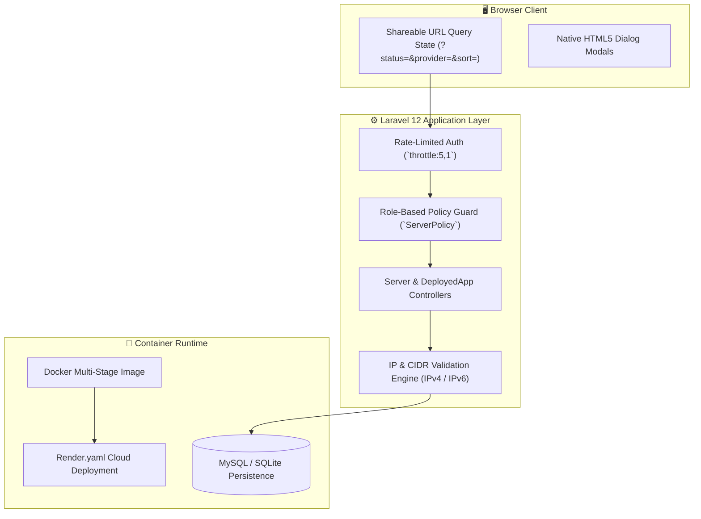

# Server Manager — Cloud & VPS Fleet Infrastructure Dashboard

[](https://laravel.com)
[](https://www.php.net)
[](https://www.docker.com)
[](https://render.com)
[]()

An infrastructure management dashboard for tracking multi-cloud VPS fleets, deployed applications, server uptime states, IP assignments (IPv4/IPv6), and upcoming hosting renewal deadlines. Built with **Laravel 12** and **PHP 8.3**, designed with a **progressive enhancement philosophy** (100% functional with or without JavaScript, URL query state serialization, native HTML5 dialog modals, and Docker containerization).

---

## 🏛️ System Architecture



---

## 🌟 Core System Features

### 1. 🖥️ Multi-Cloud VPS Fleet Registry
- **Comprehensive Instance Tracking:** Monitor server hostnames, public/private IP addresses (IPv4 and IPv6 format validation), operating systems, and cloud providers (DigitalOcean, AWS, Hetzner, Linode, Vultr).
- **Deployed Applications Indexing:** Associate multiple software applications (`DeployedApp` model) per server instance with port mapping and environment tags.
- **Renewal Alert Engine:** Automated identification of server renewal horizons due within $\le 30$ days to prevent inadvertent service termination.

### 2. 📊 Executive Metric Dashboard & Filter Engine
- **Summary Metrics:** 6 real-time KPI stat cards: Total Instances, Active Nodes, Payment Required, Inactive/Suspended Nodes, Deployed Apps, and Upcoming Renewals.
- **Zero-JS Progressive Filtering:** Instant filtering across providers, statuses, and ownership with bi-directional sorting. Filter state is serialized into clean, shareable URL query parameters.

### 3. 🔐 Granular Role Authorization (`ServerPolicy`)
- **First-User Bootstrap:** The initial registered user is automatically provisioned as `admin`; subsequent accounts are assigned `member` roles.
- **Scoped Tenant Authority:** Members manage their own server nodes; administrators have global oversight and destructive bulk management permissions.

### 4. 🐳 Cloud-Native Docker & Render Infrastructure
- Packaged with an optimized production `Dockerfile`, automated `entrypoint.sh` execution script, and `render.yaml` blueprint for one-click deployment.

---

## 🛠️ Technology Stack

| Layer | Technologies |
|---|---|
| **Core Framework** | Laravel 12.x, PHP 8.3+ |
| **Frontend Styling** | Tailwind CSS, Blade Components, Native `<dialog>` elements |
| **Architecture Pattern** | Progressive Enhancement (SSR with query-string state) |
| **Authentication & Auth** | Custom Session Authentication with `ServerPolicy` RBAC |
| **Database** | MySQL 8.0 / SQLite 3 |
| **Deployment & Containers**| Docker, Dockerfile, Render Blueprint (`render.yaml`) |
| **Testing & Quality** | PHPUnit 12, Laravel Pint |

---

## 📂 Domain Organization

```
server-manager/
├── app/
│   ├── Http/Controllers/
│   │   ├── LoginController.php        # Rate-limited authentication
│   │   ├── RegisterController.php     # Account creation with auto-admin rule
│   │   └── ServerController.php       # Fleet CRUD, status toggles & bulk actions
│   ├── Models/
│   │   ├── DeployedApp.php            # Applications hosted on servers
│   │   ├── Server.php                 # Core VPS instance model
│   │   └── User.php                   # Team members & administrator roles
│   └── Policies/
│       └── ServerPolicy.php           # Scoped resource authorization
├── Dockerfile                         # Production container image
├── entrypoint.sh                      # Container runtime initializer
├── render.yaml                        # Infrastructure-as-code deployment blueprint
├── routes/
│   └── web.php                        # Resource routes & status patch endpoints
└── composer.json
```

---

## ⚙️ Local Development & Quick Start

### Prerequisites
- **PHP:** `>= 8.3` (Extensions: `pdo_mysql`, `mbstring`, `openssl`, `curl`)
- **Composer:** `>= 2.5`
- **Node.js & NPM:** `Node 18+` / `NPM 9+`
- **Database:** MySQL 8.0+ or SQLite

### Local Setup Instructions

```bash
# 1. Clone the repository
git clone https://github.com/alramim07/server-manager.git
cd server-manager

# 2. Install dependencies
composer install
npm install

# 3. Environment configuration
cp .env.example .env
php artisan key:generate

# 4. Database configuration in .env
# DB_CONNECTION=mysql
# DB_HOST=127.0.0.1
# DB_PORT=3306
# DB_DATABASE=server_manager
# DB_USERNAME=root
# DB_PASSWORD=

# 5. Run migrations & populate demo fleet data
php artisan migrate --seed

# 6. Build assets & serve
npm run build
php artisan serve
```

Access the dashboard at: **`http://127.0.0.1:8000`**

---

## 🐳 Docker Deployment

```bash
# Build and run with Docker
docker build -t server-manager .
docker run -p 8000:80 server-manager
```

---

## 🧪 Testing & Code Quality

```bash
# Run PHPUnit test suite
php artisan test

# Verify PSR-12 code style compliance
./vendor/bin/pint --test
```

---

## 📄 License
This project is open-source software licensed under the [MIT License](LICENSE).
